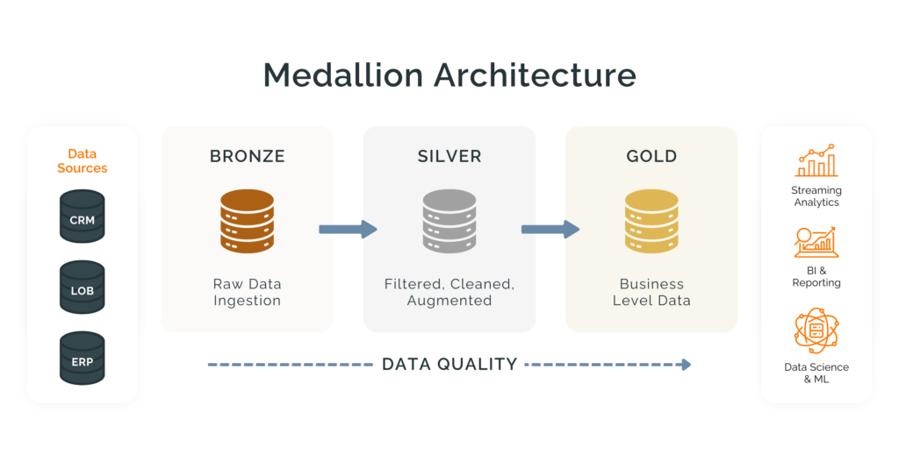
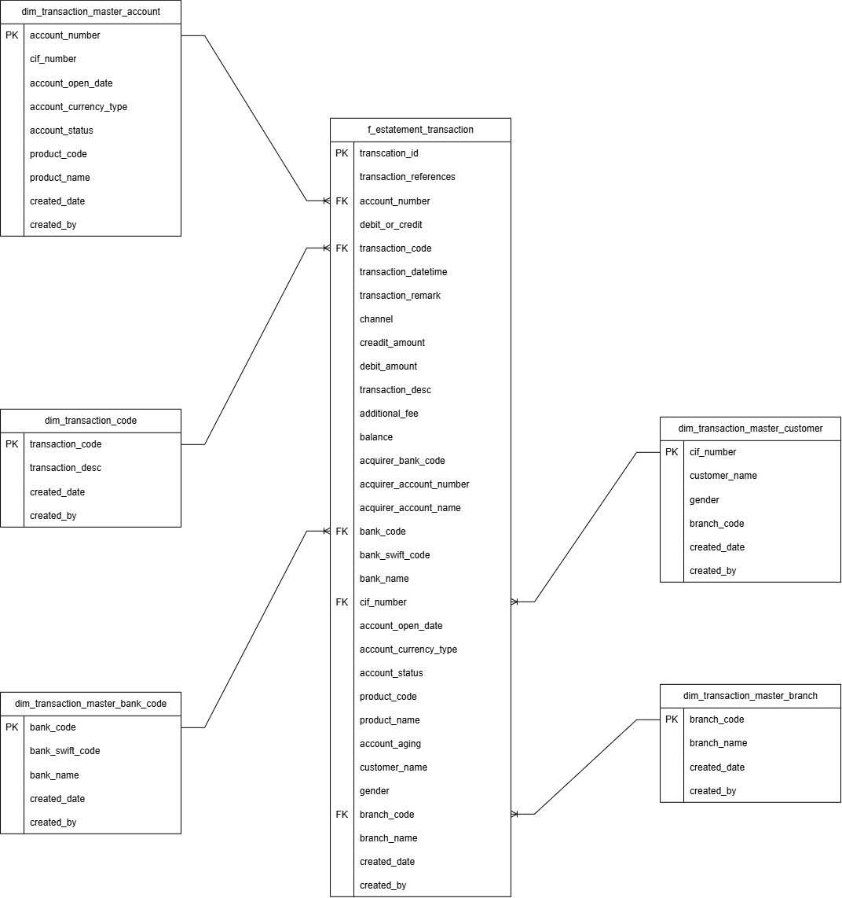
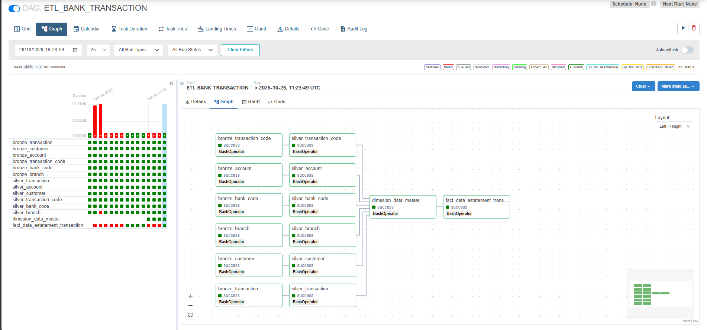

# E-Statement Data Engineering Pipeline

An automated ETL pipeline for processing e-statement transaction data using Python, Apache Airflow, PostgreSQL, and Docker. This project implements the Medallion Architecture to organize data processing from raw ingestion to analytical data modeling.

## Project Overview

This project demonstrates an end-to-end data engineering workflow for e-statement transaction data. The pipeline extracts source data, performs data cleansing and transformation, and prepares analytical data in the Gold layer using a Star Schema model.

The workflow is orchestrated using Apache Airflow, while PostgreSQL is used to store data across the Bronze, Silver, and Gold layers.

## Architecture

The pipeline follows the Medallion Architecture.

### Bronze Layer
Stores raw data extracted from source files and systems.

### Silver Layer
Cleans and transforms data, standardizes data types, handles duplicates and missing values where appropriate, and prepares transaction and master data for downstream processing.

### Gold Layer
Integrates transaction data with master data and organizes analytical data into dimension tables and a transaction fact table using a Star Schema.



## Data Model

The Gold layer uses a Star Schema centered on the `f_estatement_transaction` fact table.

The dimension tables provide descriptive information for transaction analysis, including account, customer, transaction code, bank, and branch information.



## ETL Pipeline Execution

The ETL workflow is orchestrated using Apache
Airflow, with task dependencies across the
Bronze, Silver, and Gold layers.




## Tech Stack

- **Programming Language:** Python
- **Data Processing:** Pandas, NumPy
- **Database:** PostgreSQL
- **Workflow Orchestration:** Apache Airflow
- **Containerization:** Docker and Docker Compose
- **SQL:** Database definition, transformation, and data loading

## Project Structure

```text
belajar-etl/
├── dags/
├── python_scripts/
│   └── scripts/
├── sql/
│   ├── 00_database.sql
│   ├── 01_bronze_ddl.sql
│   ├── 02_silver_ddl.sql
│   └── 03_gold_ddl.sql
├── docs/
│   ├── medallion_architecture.png
│   └── erd_gold_star_schema.png
├── .env.example
├── .gitignore
├── Dockerfile
├── docker-compose.yaml
├── requirements.txt
└── README.md
```

## Database Design

The project uses three separate PostgreSQL databases:

- **Bronze:** raw source data.
- **Silver:** cleaned and standardized data.
- **Gold:** dimension tables and the transaction fact table.

Database creation and table definitions are provided in the `sql/` directory.

## Prerequisites

- Docker Desktop
- Git
- Access to a PostgreSQL instance
- Source data that is authorized for use
- Environment variables configured for the database connections

## Setup and Execution

### 1. Clone the Repository

```bash
git clone https://github.com/Muhrannn/E-Statement-Data-Engineering-Pipeline.git
cd E-Statement-Data-Engineering-Pipeline
```

### 2. Configure Environment Variables

Create a local `db.env` file based on `.env.example` in folder scripts/.

Configure the database host, port, username, password, and database names. Do not commit `db.env` or other files containing credentials.

### 3. Create the Databases and Tables

1. Connect to the PostgreSQL server using DBeaver or another PostgreSQL client.

2. Execute sql/00_database.sql to create the Bronze, Silver, and Gold databases. The database user must have the required privileges.

3. Open a SQL Editor connected to each database and execute its corresponding DDL file:
- sql/01_bronze_ddl.sql in the Bronze database.
- sql/02_silver_ddl.sql in the Silver database.
- sql/03_gold_ddl.sql in the Gold database.

4. Verify that the tables have been created successfully before running the Airflow pipeline.

### 4. Start Docker Services

From the project root directory, run:

```bash
docker compose up -d --build
```

Verify that the required containers are running:

```bash
docker compose ps
```

### 5. Run the ETL Pipeline

1. Open the Airflow web interface using the URL and port configured in `docker-compose.yaml`.
2. Enable the ETL DAG if it is paused.
3. Trigger the DAG from the Airflow interface.
4. Monitor task execution and logs.
5. Verify the resulting data in the Bronze, Silver, and Gold PostgreSQL databases.

## Data Privacy

Credentials and confidential source data are excluded from the public repository. Use authorized or synthetic datasets when reproducing this project.

## Future Improvements

- Improve logging, monitoring, and failure notifications.
- Add analytical queries and reporting examples.

## Author
- Muhammad Ferran Hilmadiansyah 